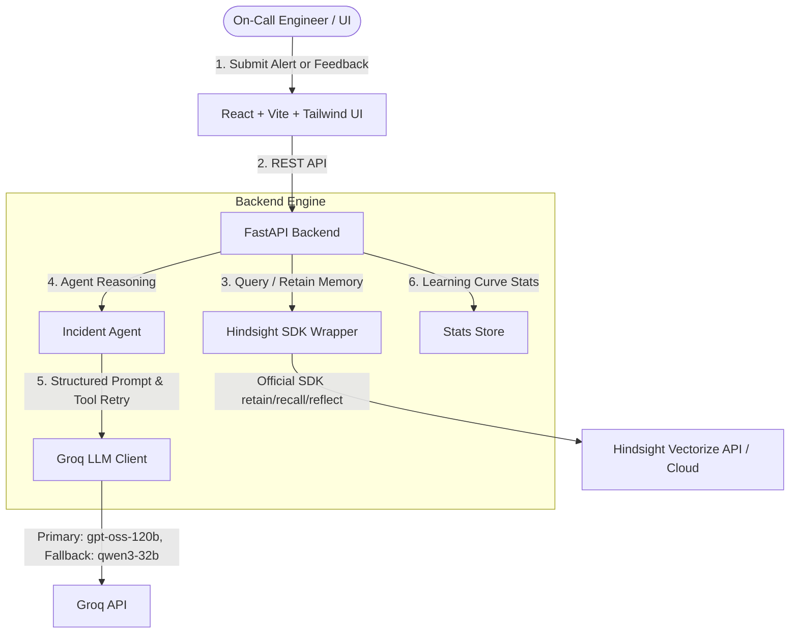

<div align="center">

# ⚡ IncidentMind

### **Self-Learning On-Call Incident Response Agent for Fintech Payment Gateways**
*🏆 Top 3 Winner — Hack with Hyderabad (24-Hour Competitive Hackathon)*

[-FFD700?style=for-the-badge)](https://github.com/bharathnow/HackwithHyderabad)
[](https://fastapi.tiangolo.com/)
[](https://react.dev/)
[](https://tailwindcss.com/)
[](https://groq.com/)
[](https://vectorize.io/)

[Overview](#-overview) • [Key Features](#-key-features) • [Architecture](#-architecture) • [Hindsight Memory](#-how-hindsight-memory-is-used) • [Quick Start](#-quick-start-local-setup) • [Docker](#-running-with-docker)

</div>

---

## 📌 Overview

**IncidentMind** is an intelligent AI incident response agent engineered for fintech payment infrastructure teams handling mission-critical, high-volume UPI and card gateway outages.

Unlike naive RAG systems or static LLM prompts, **IncidentMind maintains an evolving, self-correcting memory bank** of past incident signatures, root causes, remediation scripts, historical success rates, and engineer attributions. When an alert fires, it recalls proven precedents from **Hindsight (Vectorize)** vector memory and recommends remedies ranked strictly by past resolution efficacy.

When engineers confirm or reject recommendations via "Fix Worked" or "Fix Failed", IncidentMind records the feedback to adjust confidence scores and downgrade regressive solutions.

---

## ✨ Key Features

1. 🚨 **Alert Intake & Triage**: Paste raw error logs or select quick presets (`payment-gateway`, `upi-switch`, `ledger-service`, `auth-service`).
2. 🧠 **Hindsight TEMPR 4-Way Recall & Agent Reasoning**: Recalls matching historical incidents and ranks recommendations strictly by past success rate %.
3. 🔄 **Self-Correcting Feedback Loop**: "Fix worked" and "Fix failed" buttons retain outcome updates to Hindsight so memory self-corrects over time.
4. ⚖️ **Before/After Side-by-Side Toggle**: Compare generic LLM response (Memory OFF) vs IncidentMind response (Memory ON) side-by-side.
5. 🔍 **Memory Inspector Panel**: Real-time right sidebar inspecting Hindsight retained memories, recalled evidence snippets, and `reflect()` synthesis.
6. 📈 **Learning Curve Chart**: Visualizes first-suggestion success rate growth over time (from 45% baseline up to 92%+).
7. 🛡️ **Proactive Deployment Risk Warning**: Evaluates proposed code/config changes against past incident memories to warn before outages happen.
8. ⚡ **Synthetic History Generator**: One-click "Seed History" populates 60+ realistic 6-month past incidents, including edge cases (conflicting advice, flaky fixes, repeated incidents).

---

## 🏛️ Architecture



---

## 🧠 How Hindsight Memory is Used

IncidentMind uses the official **Hindsight (Vectorize)** SDK (`hindsight-client`) for agentic memory operations:

### 1. `retain()` & `retain_batch()`
Stores structured incident memories into the `incidentmind-bank` memory bank.
- **What is stored**: Incident ID, timestamp, target service, error code signature, log stack trace, root cause, fix applied, outcome (`WORKED` or `FAILED`), engineer name, and caveat notes.
- **Self-Correction**: When an engineer clicks "Fix worked" or "Fix failed", a new feedback memory observation is retained into Hindsight, updating the bank's beliefs.

### 2. `recall()`
Uses Hindsight's **TEMPR 4-Way Retrieval** (combining world facts, observations, and experience memories with exact source chunk extraction) to retrieve past incidents matching the incoming error signature.

### 3. `reflect()`
Runs agentic reflection across the memory bank to synthesize macro trends, reconcile conflicting advice (e.g., PgBouncer query pooling vs raw Postgres `max_connections` increase), and generate evidence-grounded insights.

---

## 🚀 Quick Start (Local Setup)

### Prerequisites
- Python 3.10+
- Node.js 18+

### 1. Environment Configuration
Copy `.env.example` to `.env`:
```bash
cp .env.example .env
```
Fill in your API keys:
```ini
GROQ_API_KEY=gsk_your_groq_api_key_here
PRIMARY_LLM_MODEL=openai/gpt-oss-120b
FALLBACK_LLM_MODEL=qwen/qwen3-32b

# Hindsight Configuration
# Hindsight Cloud: https://api.hindsight.vectorize.io
# Local Open-Source Hindsight Server: http://localhost:8888
HINDSIGHT_BASE_URL=http://localhost:8888
HINDSIGHT_API_KEY=your_hindsight_api_key_here
HINDSIGHT_BANK_ID=incidentmind-bank
```

### 2. Backend Setup
```bash
cd backend
python -m venv venv
# On Windows: venv\Scripts\activate | On Linux/Mac: source venv/bin/activate
pip install -r requirements.txt
python -m uvicorn app.main:app --host 0.0.0.0 --port 8000
```

### 3. Frontend Setup
```bash
cd frontend
npm install --ignore-scripts
node node_modules/vite/bin/vite.js
```
Open [http://localhost:5173](http://localhost:5173) in your browser.

---

## 🐳 Running with Docker

You can run both IncidentMind and a local open-source Hindsight vector memory server using Docker Compose:

```bash
docker-compose up --build
```
Access the application at [http://localhost:8000](http://localhost:8000).

---

## 🧪 Running Tests

```bash
# Run backend memory and LLM unit tests
$env:PYTHONPATH="backend"
python -m pytest backend/tests/
```

---

<div align="center">
  <sub>Developed by <a href="https://github.com/bharathnow">Mothukuri Bharath</a> • Top 3 at Hack with Hyderabad</sub>
</div>